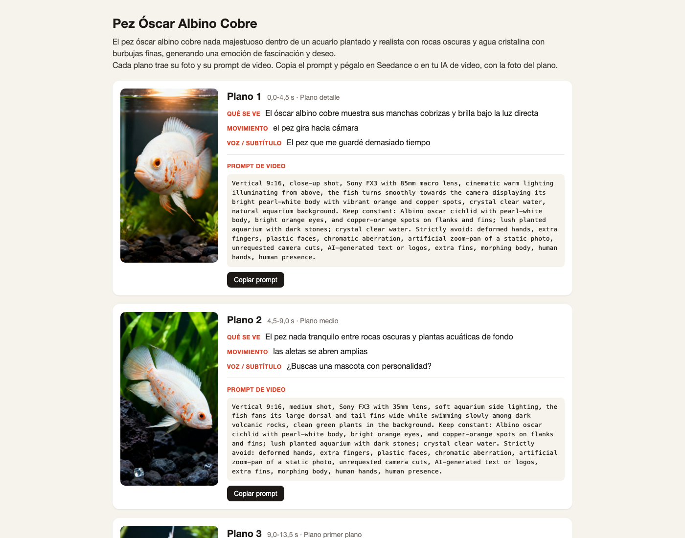

# Demostración: caso real, antes y después

**Tarea auténtica:** revisar el guion de mi último reel del pez óscar antes de llevarlo a una IA de video. Necesito ver cada plano con su movimiento y abrir el storyboard (una foto por plano con su prompt).

Las salidas de abajo son reales: se copiaron de la terminal el 13-nov-2026, con la app Director de Reels encendida y opencode con el modelo gratis `opencode/big-pickle`.

## Antes (sin el MCP)

Había que hacerlo a mano en el Finder:

1. Abrir el Finder e ir a `Escritorio › Proyectos › Reels › director-de-reels › reels-creados`.
2. Buscar la carpeta correcta entre **374 carpetas** con nombres del tipo `2026-11-10_1706_pez-oscar-cobre-angulos-distintos`. Hay 4 reels del pez óscar, así que hay que fijarse en la fecha.
3. Entrar a `storyboard/` y abrir `storyboard.html`.
4. Para saber el movimiento de cada plano: leerlo en el storyboard, plano por plano, o abrir `meta.json`.

Además, en la carpeta hay varias versiones de cada foto (`plano-2_v1.png`, `plano-2_v2.png`, `plano-2_v3.png`), y desde el Finder no se sabe cuál es la vigente.

## Después (con el MCP)

### Pedido 1: ver qué hay

**Le escribí a la IA:** ¿Qué reels tengo? Muéstrame los 3 más recientes

**Qué ejecutó el MCP:** `director-de-reels_listar_reels {"limite":3}`

**Qué respondió (12 s):**

> Tienes 374 reels en total. Los 3 más recientes:
>
> | # | Reel | Fecha | Planos | Fotos | Costo |
> |---|------|-------|--------|-------|-------|
> | 1 | Pez Oscar cobre angulos distintos | 10-11, 5:06 p. m. | 5 | 5/5 | $1,18 |
> | 2 | Pez Óscar Albino Cobre se mueve | 10-11, 4:04 p. m. | 5 | 5/5 | $1,47 |
> | 3 | Pez Oscar Albino con manchas naranjas | 30-10, 4:38 p. m. | 5 | 4/5 | $0,91 |
>
> Todos tienen storyboard. El tercero tiene una foto pendiente (4 de 5).

### Pedido 2: revisar el guion y abrir el storyboard

**Le escribí a la IA:** Abre el storyboard del pez oscar y dime qué movimiento tiene cada plano

**Qué ejecutó el MCP:** `director-de-reels_abrir_storyboard {"reel":"pez oscar"}` y `director-de-reels_ver_reel {"reel":"pez oscar"}`

**Qué respondió (12 s):**

> Storyboard abierto en el navegador: `2026-11-10_1706_pez-oscar-cobre-angulos-distintos`.
>
> Movimiento por plano:
> 1. **0,0-4,5 s** (detalle): el pez gira hacia cámara
> 2. **4,5-9,0 s** (medio): las aletas se abren amplias
> 3. **9,0-13,5 s** (primer plano): los ojos siguen la cámara
> 4. **13,5-18,0 s** (general): el pez cruza el tanque
> 5. **18,0-22,5 s** (detalle): las burbujas suben rápido
>
> Ojo: había otros 3 reels que también calzaban con "pez oscar". Si querías otro, dame el ID.

**El storyboard que se abrió en el navegador:**



## Resultado

| | Antes | Después |
|---|---|---|
| Qué hago yo | Recorrer 5 carpetas, elegir entre 374 y abrir 2 archivos | Escribir una frase |
| Elegir el reel correcto | Por la fecha del nombre de la carpeta | Lo elige la herramienta: el más nuevo con storyboard, y avisa si hay otros parecidos |
| Ver el movimiento de cada plano | Leer el storyboard o el JSON | Lista lista para revisar |
| Saber el costo | Abrir `meta.json` | Viene en la tabla |

Lo que gané no es solo tiempo: queda a la vista lo que importa para revisar el guion (movimiento por plano, fotos pendientes y costo), y mi trabajo pasa a ser decidir si el reel sirve.

## Repetir esta demostración

```bash
npm run build
npm run probar-director      # prueba las 6 herramientas contra la app encendida
opencode -m opencode/big-pickle
```

Escribe los mismos dos pedidos. Los títulos y costos van a ser los de tus propios reels.
