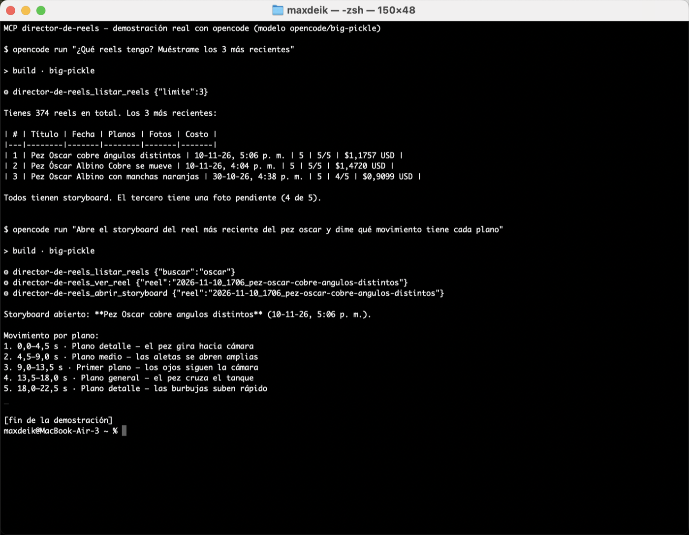

# MCP Director de Reels

Un servidor **MCP** (Model Context Protocol) que conecta una IA (opencode, Claude Desktop, Cursor…) con **Director de Reels**, la app que construí en el Certamen 2 del ramo *ChatGPT y Tecnologías de IAG para el Trabajo Académico* (UDD, CTR20233).

Director de Reels arma el guion de un reel plano por plano y crea una foto por plano. Con este MCP, en vez de buscar carpetas a mano, le pido a la IA en lenguaje natural: *"¿qué reels tengo?"*, *"ábreme el storyboard del pez oscar"* o *"¿cuánto llevo gastado este mes?"*.

**Demostración en video (35 s, grabada el 13-nov-2026):** [docs/video/demo-opencode.mp4](docs/video/demo-opencode.mp4). Muestra opencode haciendo dos pedidos, el MCP llamando a sus herramientas y el storyboard abriéndose en el navegador.



Autor: Max Deik. Hecho a partir del [mcp-starter-kit](https://github.com/Maurichilean3d/mcp-starter-kit) del curso (rama `main`, licencia MIT).

| Documento | Qué tiene |
|---|---|
| [UTILIDAD-ACADEMICA.md](UTILIDAD-ACADEMICA.md) | Qué problema resuelve, para quién y en qué dimensión del aprendizaje aporta (1 página) |
| [DEMO.md](DEMO.md) | Caso real, antes y después, con lo que se pidió y lo que respondió |
| [DECLARACION-IA-Y-SEGURIDAD.md](DECLARACION-IA-Y-SEGURIDAD.md) | Uso de IA, límites conocidos y seguridad |
| [BITACORA.md](BITACORA.md) | Trazabilidad: cada paso con su comando, la salida real y los errores resueltos |

## Herramientas

| Herramienta | Qué hace | ¿Cambia algo? |
|---|---|---|
| `estado_director` | Revisa si la app está abierta, si tiene clave para guiones y si el motor de fotos está disponible | No, solo lee |
| `listar_reels` | Lista los reels del más nuevo al más viejo (título, fecha, planos, fotos, costo). Filtra por palabras del título | No, solo lee |
| `ver_reel` | Muestra el guion de un reel plano por plano: tiempo, tipo de plano, movimiento y foto actual | No, solo lee |
| `abrir_storyboard` | Abre en el navegador el storyboard del reel (una foto por plano) | Abre una ventana, y la app rehace `storyboard.html` desde `meta.json` |
| `abrir_carpeta_reel` | Abre en el Finder la carpeta del reel | Abre una ventana |
| `gasto_modal` | Dice cuánto se ha gastado este mes en Modal, el servicio que genera las fotos | No, solo lee (la app le consulta a Modal por internet) |

Las dos herramientas de ejemplo del kit (`listar_aplicaciones` y `abrir_aplicacion`) quedaron **desactivadas** (archivo `src/tools/_aplicaciones.ts`; el kit ignora los archivos que empiezan con `_`). Podían abrir cualquier app del computador y este MCP no las necesita, así que los permisos quedan acotados a las 6 herramientas de arriba.

**Lo que este MCP no hace a propósito:** crear guiones ni fotos. Esas acciones cuestan dinero (Gemini y Modal), y lo que cuesta dinero no se le deja decidir a un modelo.

## Cómo funciona

```
Tú  →  opencode (IA)  →  este MCP (stdio)  →  API local del Director (http://127.0.0.1:8895)
                                           →  carpeta reels-creados/ (solo lectura)
```

El MCP no hace clics ni toca el código de la app. Le habla a la API HTTP que la app ya tenía. Es la vía más robusta según la guía del kit: API, luego línea de comandos, luego archivos, luego AppleScript, y la interfaz al final.

## Requisitos

- **macOS** (las herramientas que abren ventanas usan el Finder y el navegador del Mac).
- **Node.js 18 o superior** y **npm** (probado con Node 20).
- **La app Director de Reels encendida** en el mismo computador (servidor en el puerto 8895). Sin la app, `listar_reels` igual funciona si existe la carpeta de reels, y las demás herramientas responden "el Director está apagado" sin colgarse.
- Un cliente MCP: [opencode](https://opencode.ai) (es el que se usó), Claude Desktop, Cursor u otro. Si no tienes opencode, el kit lo instala con `npm run instalar-ia`, o se instala desde su página.

## Instalación paso a paso

1. Descarga el repositorio:
   ```bash
   git clone https://github.com/MrChubby21/mcp-director-de-reels.git
   cd mcp-director-de-reels
   ```
2. Instala y compila:
   ```bash
   npm install
   npm run build
   ```
3. Corre la prueba de humo del kit. Debe decir `OK: 6 herramientas` y terminar con `Prueba de humo superada.`:
   ```bash
   npm test
   ```
4. Abre la app Director de Reels y corre la prueba real. Llama a las 6 herramientas contra la app encendida (las dos que abren ventanas, con un reel que no existe, para no abrir nada) y debe terminar con `Prueba del Director superada.`:
   ```bash
   npm run probar-director
   ```
5. Abre opencode en esta carpeta. El archivo `opencode.json` ya registra el MCP con el nombre `director-de-reels`:
   ```bash
   opencode
   ```
   Si quieres usar el modelo gratis con el que se probó: `opencode -m opencode/big-pickle`.

### Si no tienes la app Director de Reels

La app es mía y no está en este repositorio. Para que igual puedas ver el MCP con datos reales, la carpeta `ejemplo/reels-creados/` trae **2 reels reales** del Director (su `meta.json` y su storyboard, con fotos achicadas):

```bash
DIRECTOR_REELS_DIR=./ejemplo/reels-creados npm run probar-director
```

Con eso, `listar_reels` muestra los 2 reels con su título, planos, fotos y costo, y el storyboard se puede abrir a mano en `ejemplo/reels-creados/<reel>/storyboard/storyboard.html`. Las herramientas que necesitan la app responden *"El Director de Reels esta apagado"*, y la prueba termina diciendo cuántas fallaron por eso. Para opencode: `DIRECTOR_REELS_DIR=./ejemplo/reels-creados opencode`.

En resumen, sin la app:

| Paso | ¿Se puede repetir? |
|---|---|
| 1 a 3 (`npm install`, `npm run build`, `npm test`) | Sí, completos |
| 4 (`npm run probar-director`) | Corre, pero las herramientas que usan la API responden *"El Director de Reels esta apagado"* y la prueba termina diciendo cuántas fallaron. Así se comprueba que el MCP no se cuelga sin la app |
| 5 (opencode) | El MCP aparece conectado; las respuestas dirán que la app está apagada |

Este repositorio sirve además como ejemplo de cómo conectar un MCP a cualquier app con una API HTTP local: se cambia `DIRECTOR_URL` y las rutas que llama `src/tools/director_reels.ts`.

### Archivos heredados del kit

Este repositorio parte del kit del profesor y conserva sus archivos, por si alguien quiere crear otro MCP desde aquí. **Para usar este MCP no hacen falta:**

| Archivo o carpeta | Qué es |
|---|---|
| `Iniciar.command`, `Iniciar.bat`, `install.sh`, `install.ps1`, `instalador/` | Instaladores y menú del kit (Mac y Windows) |
| `constructor/` | Constructor web del kit para crear MCPs |
| `templates/`, `scripts/new-tool.mjs` | Plantilla para agregar herramientas nuevas |
| `docs/` (salvo `docs/img/`) | Guías del kit; su README original está en `docs/KIT-ORIGINAL-README.md` |
| `src/tools/_ejemplo.ts`, `src/tools/_aplicaciones.ts` | Herramientas de ejemplo del kit, desactivadas |

Lo propio de este MCP: `src/tools/director_reels.ts`, `scripts/probar-director.mjs`, `ejemplo/` y los documentos de la raíz.

### Configuración opcional

| Variable | Para qué | Valor por defecto |
|---|---|---|
| `DIRECTOR_URL` | Dirección del servidor del Director | `http://127.0.0.1:8895` |
| `DIRECTOR_REELS_DIR` | Carpeta donde el Director guarda los reels | `~/Desktop/Proyectos/Reels/director-de-reels/reels-creados` |

### Usarlo desde Claude Desktop u otro cliente

Agrega esto a la configuración MCP del cliente, con la ruta absoluta a tu carpeta:

```json
{
  "mcpServers": {
    "director-de-reels": {
      "command": "node",
      "args": ["/ruta/a/mcp-director-de-reels/dist/index.js"]
    }
  }
}
```

## Ejemplos de uso

| Le escribes a la IA | Herramientas que usa |
|---|---|
| ¿Qué reels tengo? Muéstrame los 3 más recientes | `listar_reels` |
| Abre el storyboard del pez oscar y dime qué movimiento tiene cada plano | `ver_reel` y `abrir_storyboard` |
| ¿Tengo algún reel de aros dorados? | `listar_reels` con `buscar` |
| ¿Cuánto llevo gastado este mes en fotos? | `gasto_modal` |
| ¿Está lista la app? | `estado_director` |

## Agregar una herramienta

```bash
npm run new-tool -- nombre_herramienta
```

Edita el archivo nuevo en `src/tools/`, corre `npm run build` y reinicia el cliente. El kit carga solo todos los archivos de `src/tools/`, menos los que empiezan con `_`.

## Créditos y licencia

- Base: [mcp-starter-kit](https://github.com/Maurichilean3d/mcp-starter-kit) del profesor Mauricio Reyes, licencia MIT. Su README original está en [docs/KIT-ORIGINAL-README.md](docs/KIT-ORIGINAL-README.md), y su documentación en `docs/`.
- Herramientas del Director, prueba real y documentación: Max Deik, con ayuda de IA (detalle en [DECLARACION-IA-Y-SEGURIDAD.md](DECLARACION-IA-Y-SEGURIDAD.md)).
- Licencia: MIT (ver [LICENSE](LICENSE)).
